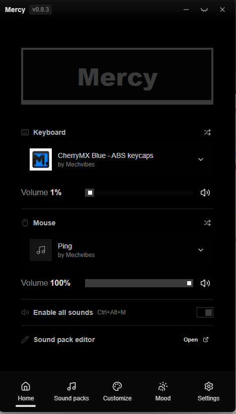

  <a href="https://github.com/Arean-Max/Mechvibes-Mercy">
    <picture>
      <source srcset="docs/logo-dark.png" media="(prefers-color-scheme: dark)">
      <source srcset="docs/logo-light.png" media="(prefers-color-scheme: light)">
      
    </picture>
  </a>

A high-performance mechanical keyboard and mouse sound simulator written in Rust with sub-10ms audio latency and zero telemetry.

  
  
  
  
  

  <a href="README.md">English</a> |
  <a href="README.zh.md">简体中文</a> |
  <a href="README.zht.md">繁體中文</a> |
  <a href="README.ko.md">한국어</a> |
  <a href="README.de.md">Deutsch</a> |
  <a href="README.es.md">Español</a> |
  <a href="README.fr.md">Français</a> |
  <a href="README.it.md">Italiano</a> |
  <a href="README.da.md">Dansk</a> |
  <a href="README.ja.md">日本語</a> |
  <a href="README.pl.md">Polski</a> |
  <a href="README.ru.md">Русский</a> |
  <a href="README.bs.md">Bosanski</a> |
  <a href="README.ar.md">العربية</a> |
  <a href="README.no.md">Norsk</a> |
  <a href="README.br.md">Português (Brasil)</a> |
  <a href="README.th.md">ไทย</a> |
  <a href="README.tr.md">Türkçe</a> |
  <a href="README.uk.md">Українська</a> |
  <a href="README.bn.md">বাংলা</a> |
  <a href="README.gr.md">Ελληνικά</a> |
  <a href="README.vi.md">Tiếng Việt</a>

  

---

### 安裝和下載

從 [**Releases**](https://github.com/Arean-Max/Mechvibes-Mercy/releases) 取得最新的預先建置版本：

- **可攜式檔案 (`Mercy-v*.zip`)** — 獨立套裝組合。解壓縮到任意位置並啟動 `mercy.exe`。在“soundpacks/”中包含開箱即用的捆綁聲音包。
---
### 亮點

- **超輕資源佔用** — 消耗約 25–40 MB RAM，而基於 Electron 的 Mechvibes 則消耗 150–300+ MB RAM。
- **專用低延遲音訊引擎** — 音訊合成和混合在獨立的系統執行緒上運行，在 100+ WPM 的打字突發期間實現低於 10 毫秒的響應時間，而不會出現音訊卡頓。
- **零 FPS 影響和防作弊安全** - 透過本機 Windows 原始輸入擷取輸入事件，而不是阻止全域鍵盤掛鉤 (`WH_KEYBOARD_LL`)。與 Vanguard、VAC、Faceit 和 EAC 並駕齊驅。
- **同步鍵盤和滑鼠音景** — 獨立的音包分配、音量控制和平移按鍵和滑鼠點擊。
- **32 複音** — 並發聲音播放，不會出現爆音、削波或聲音遺失的情況。
- **通用聲音包相容性** — 適用於舊版 Mechvibes v1 和 v2 格式的本機解析器（支援 WAV、MP3、OGG 和 FLAC）。
- **100% 離線和私密** — 零分析、遙測追蹤器（已刪除 Aptabase）和網路請求。
---
### 聲音套件管理

1. **拖曳** — 將任何聲音包資料夾直接拖曳到應用程式視窗中，或導覽至 **設定 → 聲音包 → 匯入聲音包**。
2. **目錄解析** — 從「%APPDATA%\Mechvibes\soundpacks」或二進位檔案旁的本機「./soundpacks」目錄讀取使用者聲音套件。
---
### 常見問題解答

#### Mercy 與原始 Mechvibes 有何不同？
Mercy 是 Mechvibes 的完全 Rust 重寫。繁重的 Chromium/Node.js 運行時被本機系統呼叫和高效能音訊線程取代，將 RAM 消耗削減了約 85%，並消除了輸入延遲。

#### 反作弊軟體會標記 Mercy 嗎？
Mercy 透過 Windows 原始輸入 (“WM_INPUT”) 讀取擊鍵，這與遊戲滑鼠和鍵盤使用的標準輸入機制相同。它永遠不會將程式碼注入目標進程、掛鉤「WH_KEYBOARD_LL」或觸及遊戲記憶體。

#### 我的聲音包儲存在哪裡？
Soundpack 位於 `%APPDATA%\Mechvibes\soundpacks` 中，或直接與可移植執行檔一起位於 `soundpacks/` 中。支援 Mechvibes v1 和 v2 資料夾結構以及 `config.json` 規範。

#### 有哪些全域快速鍵可用？
- `Ctrl + Alt + M` — 全域切換靜音/取消靜音音訊。
- 關閉按鈕直接最小化到系統托盤，以實現不顯眼的後台操作。
---
### 文檔和架構

- [系統架構](docs/system-architecture.md) — 執行緒模型、輸入輪詢管道和音訊混合圖
- [Soundpack 設定 v2](docs/soundpack-config-v2.md) — 設定架構和 soundpack 目錄結構
- [部署指南](docs/deployment-guide.md) — 交叉編譯和打包說明
- [互動式圖](https://gitdiagram.com/Arean-Max/Mechvibes-Mercy) — 視覺架構概述
---
### 從原始碼構建

先修條件：Rust 工具鏈 (1.88+)。

___程式碼區塊_0___

編譯後的二進位檔案將會放置在「target/release/mercy.exe」。
---
### 許可證

[MIT]（許可證）—最初基於 Hai Nguyen 的 [mechvibes-dx](https://github.com/hainguyents13/mechvibes-dx)。